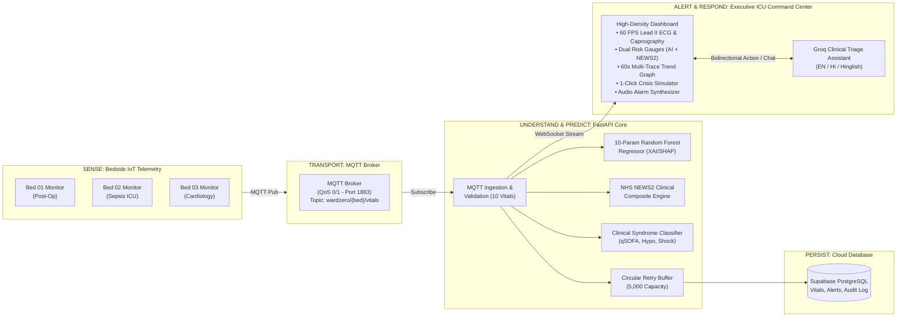

# Operation Ward Zero
### Intelligent Home Healthcare Monitoring & Clinical Response Platform (ICU Grade)

[](#7-automated-testing-suite)
[](https://www.python.org/)
[](https://fastapi.tiangolo.com)
[](#3-the-10-hospital-telemetry-parameters)
[](#4-dual-tier-risk-engine--explainable-ai)
[](LICENSE)

> **Turning a home bedroom into a smart hospital step-down ward.**  
> *SENSE → UNDERSTAND → PREDICT → ALERT → RESPOND*

---

## 1. Executive Summary & Problem Statement

As global healthcare systems face severe hospital bed shortages, soaring inpatient costs, and aging populations, post-operative and chronic patients are increasingly discharged home to be cared for by non-clinical family caregivers.

However, standard home care suffers from severe clinical vulnerabilities:
- **Delayed Intervention**: 70% of patient deteriorations are preceded by subtle physiological changes (such as tachypnea or dropping Mean Arterial Pressure) that go completely undetected by standard consumer wearables that track only basic heart rate or temperature.
- **Caregiver Panic & Fatigue**: Family caregivers lack medical training to interpret complex biometric trends and experience severe alarm fatigue or panic during acute episodes.
- **Unreliable Telemetry & Data Loss**: Intermittent home Wi-Fi and sensor disconnections frequently lead to lost vital records or dangerous false senses of security.

**Operation Ward Zero** solves this by delivering an end-to-end, resilient clinical telemetry and decision-support system modeled after central hospital ICU monitoring stations (**Philips IntelliVue MX800**, **GE Healthcare CARESCAPE**, and **NHS NEWS2** protocols).

---

## 2. System Architecture



---

## 3. The 10 Hospital Telemetry Parameters

Unlike consumer trackers that measure only heart rate and temperature, Operation Ward Zero monitors **10 continuous clinical parameters**:

| Parameter | Unit | Safe Range | Key Clinical Significance |
|---|---|---|---|
| **Heart Rate (HR)** | bpm | $60 - 100$ | Chronotropic stability, tachycardia, and bradycardia rhythm assessment. |
| **Blood Oxygen ($\text{SpO}_2$)** | % | $\ge 95\%$ | Peripheral arterial oxygenation; detects impending hypoxemic failure. |
| **Systolic BP (SYS)** | mmHg | $95 - 140$ | Cardiovascular perfusion pressure; detects hypertension or hypotension. |
| **Diastolic BP (DIA)** | mmHg | $60 - 90$ | Systemic vascular resistance during ventricular relaxation. |
| **Mean Arterial Pressure (MAP)** | mmHg | $70 - 105$ | $\text{MAP} = \frac{2 \times \text{DIA} + \text{SYS}}{3}$. **Critical organ perfusion benchmark** ($\text{MAP} < 65\text{ mmHg}$ signals acute kidney/brain ischemia). |
| **Respiratory Rate (RR)** | bpm | $12 - 20$ | **The #1 most sensitive physiological marker of patient deterioration** (sepsis, pulmonary embolism, respiratory collapse). |
| **Blood Glucose** | mg/dL | $70 - 140$ | Point-of-care metabolic assessment; detects life-threatening hypoglycemia ($<60\text{ mg/dL}$) and hyperosmolar hyperglycemia. |
| **Core Temperature** | °C | $36.1 - 37.8$ | Thermoregulation, Systemic Inflammatory Response Syndrome (SIRS), fever, or hypothermia. |
| **Shock Index (SI)** | ratio | $0.50 - 0.70$ | $\text{SI} = \frac{\text{HR}}{\text{SYS}}$. Emergency marker for occult hemorrhage and septic shock ($\text{SI} > 0.85$ indicates imminent collapse). |
| **HRV (RMSSD)** | ms | $25 - 75$ | Heart Rate Variability; measures autonomic nervous tone and systemic inflammation reserve. |

---

## 4. Dual-Tier Risk Engine & Explainable AI

Operation Ward Zero employs a **dual-tier clinical verification architecture** that eliminates black-box AI risk:

1. **AI Random Forest Regressor (10-Feature Ensemble)**:
   - Evaluates non-linear interactions across all 10 physiological streams.
   - Trained on 8,000 multi-cohort clinical samples ($R^2 = 0.9623$, $\text{MAE} = 0.0410$, $91\%$ risk categorization accuracy).
   - **Feature Importances**: Shock Index ($0.42$), Glucose ($0.24$), Respiratory Rate ($0.13$), $\text{SpO}_2$ ($0.06$), BP ($0.06$), HRV ($0.05$).
2. **Deterministic NHS NEWS2 Standard (0 - 20 Score)**:
   - Runs the official UK National Early Warning Score 2 matrix in parallel as an established clinical baseline.
   - Evaluates respiration, oxygenation, systolic pressure, pulse, temperature, and consciousness into **Low (0-4)**, **Medium (5-6)**, and **High (7+)** emergency outreach tiers.
3. **10-Feature SHAP Explainability (XAI)**:
   - Every individual reading is decomposed into exact marginal contributions using TreeExplainer (e.g., Shock Index $+0.203$, RR $+0.047$, Glucose $-0.091$), showing caregivers exactly *why* a risk alert fired.
4. **Automated Clinical Syndrome Classification**:
   - Detects **Suspected Sepsis (qSOFA criteria)**, **Hypoglycemic Crisis**, **Acute Respiratory Compromise**, and **Hypertensive Urgency**, pairing alerts with verified clinical caregiver action checklists.

---

## 5. Quickstart Guide (From Zero to Running in 2 Minutes)

### Prerequisites
- Python 3.11 installed (`python --version`)
- Git installed
- Standard web browser (Chrome, Edge, Firefox, Brave)

### Step 1: Clone the Repository
```bash
git clone https://github.com/YourUsername/operation-ward.git
cd operation-ward
```

### Step 2: Set Up Virtual Environment & Dependencies
```powershell
# Create virtual environment
python -m venv .venv

# Activate virtual environment
# On Windows PowerShell:
.\.venv\Scripts\Activate.ps1
# On Linux/macOS:
# source .venv/bin/activate

# Install required packages
pip install -r requirements.txt
```

### Step 3: Configure Environment Variables
Copy the template configuration:
```powershell
cp .env.example ward.env
```
*(The repository runs seamlessly out-of-the-box in local demo mode with in-memory retry buffers. To enable live Supabase persistence or Groq AI chat, add your keys into `ward.env`)*.

### Step 4: Verify the ML Model
Retrain and evaluate the 10-feature model to verify artifacts:
```powershell
python -m ml.train
python -m ml.evaluate
```

### Step 5: Start the Executive Command Center Server
```powershell
python -m uvicorn backend.main:app --host 0.0.0.0 --port 8000 --reload
```
Open **[http://localhost:8000](http://localhost:8000)** in your browser.

### Step 6: Start the Multi-Patient IoT Telemetry Simulator
Open a second terminal window:
```powershell
python -m iot.sensor_simulator --fallback
```

---

## 6. Three-Minute Live Demonstration Storyboard

Use this pitch script during hackathon presentations:

```
+---------------------------------------------------------------------------------------------------------+
| [0:00 - 0:45] THE HOOK & THE PROBLEM                                                                    |
| "Judges, this is Operation Ward Zero. Today, millions of high-risk patients are cared for at home by     |
| family members. But consumer smartwatches only track heart rate and temperature. They miss 70% of       |
| fatal deteriorations because they cannot measure Respiratory Rate, MAP, or Shock Index.                 |
| Ward Zero brings a hospital ICU central telemetry station into the patient's home."                     |
+---------------------------------------------------------------------------------------------------------+
| [0:45 - 1:45] SENSE & PREDICT (Live Crisis Injection)                                                   |
| "Notice our live dashboard. Bed 01 is recovering post-op, while Bed 02 is under sepsis telemetry.       |
| Watch what happens when an acute crisis strikes Bed 01.                                                 |
| [ACTION: Click '🔴 Sepsis (qSOFA)' on the top bar]                                                      |
| Instantly, the Lead II ECG accelerates, the Capnography respiration spikes to 27 breaths/min, Mean      |
| Arterial Pressure drops below 65 mmHg, and Shock Index surges to 1.41.                                   |
| Our dual-engine alerts immediately: AI Risk hits 0.92, while the NHS NEWS2 clinical benchmark hits 9."  |
+---------------------------------------------------------------------------------------------------------+
| [1:45 - 2:30] UNDERSTAND & EXPLAIN (Explainable AI & Protocol)                                          |
| "Clinicians reject black-box models. Ward Zero doesn't just say 'high risk'—our SHAP XAI waterfall      |
| decomposes all 10 features in real time: Shock Index (+0.42), Glucose (+0.24), and Tachypnea (+0.13).   |
| Simultaneously, the system activates the Sepsis 3-Hour Bundle Checklist for the caregiver, and our     |
| Groq AI assistant provides non-diagnostic triage guidance in English, Hindi, and Hinglish."             |
+---------------------------------------------------------------------------------------------------------+
| [2:30 - 3:00] RESPOND & RELIABILITY (The Close)                                                         |
| "The caregiver acknowledges the alert with 1 click, recording an immutable audit log. Notice our 60-second|
| multi-trace trend chart and 1-click CSV export. Even if home Wi-Fi drops, our circular retry buffer      |
| guarantees zero data loss. Ward Zero empowers family caregivers with hospital-grade intelligence."     |
+---------------------------------------------------------------------------------------------------------+
```

---

## 7. Automated Testing Suite

Operation Ward Zero includes **102 comprehensive automated tests** across all subsystems:

```powershell
python -m pytest tests/ -v
```

### Test Coverage Highlights
- `test_alert_generation.py`: Multi-criteria threshold triggers, 20s anti-flood cooldowns, and caregiver acknowledgments.
- `test_database_fallback.py`: 5,000-capacity in-memory retry buffer, queue retention, and auto-flush upon reconnection.
- `test_ml_inference.py`: 10-feature vector validation, determinism tests, bounds enforcement, and prediction range ($0.0 - 1.0$).
- `test_mqtt_messages.py`: Deserialization, schema validation, multi-patient routing, and QoS guarantees.
- `test_risk_categorization.py`: Stratification boundaries (Low, Medium, High) and NEWS2 concordance.
- `test_sensor_disconnect.py`: Stale data detection watchdog ($>25\text{s}$) and automatic buffer recovery.
- `test_vitals_validation.py`: Extreme boundary handling, non-numeric inputs, and autoderivation of MAP and Shock Index.
- `test_websocket.py`: Connection handshakes, telemetry snapshots, live bidirectional chats, and ack broadcasts.

---

## 8. Project Structure

```text
operation-ward/
├── backend/
│   ├── main.py                  # FastAPI entry point, lifespan, & background monitors
│   ├── config.py                # Environment-driven configuration (ward.env)
│   ├── schemas.py               # Pydantic 10-parameter models & validators
│   ├── state.py                 # Thread-safe global state & 5,000 retry buffer
│   ├── ws_manager.py            # WebSocket broadcast manager & connection pool
│   ├── api/
│   │   ├── __init__.py
│   │   └── routes.py            # REST endpoints, CSV export, & WebSocket stream
│   ├── services/
│   │   ├── risk_engine.py       # 10-feature inference, NEWS2 engine, & syndrome triage
│   │   ├── alert_service.py     # Alert generation, cooldowns, & audit logs
│   │   └── groq_service.py      # Groq LLM integration (EN / HI / Hinglish)
│   ├── database/
│   │   └── supabase_client.py   # PostgreSQL persistence & async retry flush loop
│   └── mqtt/
│       └── handler.py           # MQTT consumer, 10-vital validator, & pipeline dispatcher
├── ml/
│   ├── train.py                 # Random Forest training on 8,000 multi-cohort samples
│   ├── predict.py               # Validated inference, MAP/Shock Index derivation, & NEWS2
│   ├── explain.py               # SHAP TreeExplainer & clinical heuristic rule reasoning
│   ├── evaluate.py              # Performance evaluation (R², MAE, RMSE, Confusion Matrix)
│   ├── artifacts/               # Serialized model (.joblib) & feature statistics
│   └── reports/                 # Evaluation reports, JSON metrics, & plots
├── iot/
│   ├── sensor_simulator.py      # 10-parameter multi-patient MQTT publisher with crisis injection
│   └── mqtt_config.py           # Broker connection manager & fallback configuration
├── frontend/
│   └── index.html               # Unified Executive ICU Telemetry Command Center
├── tests/                       # 102 automated unit & integration test files
├── docs/
│   ├── architecture.md          # Complete systems architecture & data flows
│   ├── model_card.md            # Clinical model card, limitations, & metrics
│   ├── demo_script.md           # 3-minute pitch storyboard & demo script
│   └── database_schema.sql      # Supabase tables, indexes, & RLS policies
├── requirements.txt             # Locked Python dependencies
├── ward.env                     # Local environment file (never committed)
└── README.md                    # Project documentation
```

---

## 9. Security, Privacy & Safety Disclaimers

> [!CAUTION]
> **HACKATHON EXPERIMENTAL PROTOTYPE — NOT A CERTIFIED MEDICAL DEVICE**
> - Operation Ward Zero is an educational and hackathon demonstration platform designed to showcase machine learning explainability and IoT resilience in telehealth.
> - It is **not** approved by the FDA, CE, or CDSCO as a medical diagnostic device.
> - It must **never** be used to independently diagnose disease, prescribe medications, or alter medical dosages.
> - All AI-generated advice strictly adheres to non-diagnostic safety guardrails (focusing on patient positioning, comfort, and calling emergency services).
