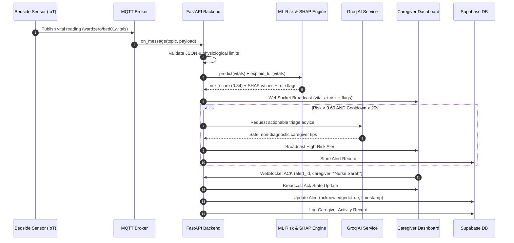

# Operation Ward Zero – System Architecture

## 1. System Vision & Objective

**Operation Ward Zero** is an intelligent, reactive home healthcare monitoring and caregiver dispatch platform designed to transform standard residential rooms into high-acuity virtual hospital wards.

The system implements the **SENSE → UNDERSTAND → PREDICT → ALERT → RESPOND** paradigm:

1. **SENSE**: Continuous telemetry streams from simulated or real bedside biometric IoT sensors.
2. **UNDERSTAND**: Normalization, physiological boundary verification, and clinical-rule heuristic analysis.
3. **PREDICT**: Instantaneous risk scoring via an experimental Random Forest ML model with SHAP feature contribution decomposition.
4. **ALERT**: Context-aware alert dispatch with anti-flooding cooldowns and triage action items.
5. **RESPOND**: Two-way caregiver acknowledgment, activity audit trail, and multilingual AI assistant triage.

---

## 2. Architecture Diagram

```mermaid
flowchart TD
    subgraph IoT_Sensors["Bedside IoT Layer (MQTT)"]
        S1["Sensor Node bed01\n(HR, SpO2, BP, Temp)"]
        S2["Sensor Node bed02\n(HR, SpO2, BP, Temp)"]
        S3["Sensor Node bed03\n(HR, SpO2, BP, Temp)"]
    end

    subgraph Broker["MQTT Broker"]
        MB["Mosquitto / HiveMQ\nTopic: wardzero/{patient_id}/vitals\nQoS 1"]
    end

    subgraph Backend["FastAPI Core Engine (Python 3.11)"]
        MH["MQTT Ingestion & Validation\n(handler.py)"]
        RE["Risk Engine\n(RandomForest + Heuristics)"]
        SHAP["SHAP TreeExplainer\n(Feature Decomposition)"]
        AS["Alert Service\n(Cooldown + UUID)"]
        LLM["Groq AI Service\n(Multilingual Triage)"]
        WS["WebSocket Broadcaster\n(ws_manager.py)"]
        RB["In-Memory Retry Buffer\n(deque maxlen=5000)"]
    end

    subgraph Cloud_DB["Persistence Layer"]
        SUPA[("Supabase PostgreSQL\n(Vitals, Alerts, Activities)")]
    end

    subgraph Frontend["Caregiver HUD Dashboard"]
        UI["Holographic Web Interface\n(Three.js + Tailwind + WebSockets)"]
        CHAT["Multilingual AI Assistant\n(English / Hindi / Hinglish)"]
        ECG["Live ECG Canvas Lead II"]
        ALERTS["Alerts & Acknowledgment Tray"]
    end

    S1 -->|Publish QoS 1| MB
    S2 -->|Publish QoS 1| MB
    S3 -->|Publish QoS 1| MB
    MB -->|Subscribe| MH

    MH -->|Validate & Clean| RE
    RE -->|Inference Score| AS
    RE -->|Local Attributions| SHAP
    AS -->|Generate Triage Advice| LLM
    AS -->|Broadcast Event| WS
    MH -->|Live Stream| WS
    MH -->|Persist Async| RB
    RB -->|Flush Thread (5s)| SUPA

    WS <-->|Full Duplex WebSocket| UI
    UI --> ECG
    UI --> CHAT
    UI --> ALERTS
    ALERTS -->|Acknowledge Action| WS
```

---

## 3. Data Flow & Alert Lifecycle



---

## 4. Reliability & Fault-Tolerance Engineering

### 4.1 In-Memory Retry Buffer
- If the Supabase database connection experiences high latency or drops entirely, writes are never dropped.
- Rows are automatically parked in a thread-safe `collections.deque(maxlen=5000)`.
- A background worker (`flush_loop`) checks connectivity every 5 seconds. Once connection resumes, buffered entries are flushed in strict chronological sequence.

### 4.2 Broker Auto-Reconnection & Offline Telemetry Buffering
- The bedside simulator buffers vital readings locally during simulated network dropouts (`d` command).
- Upon sensor reconnection (`r` command), buffered readings are delivered with a `delayed: true` flag, allowing historical reconstruction without masking offline periods.

### 4.3 Stale Data Watchdog
- A background monitor tracks the elapsed time since the last telemetry packet per patient.
- If no update arrives within 25 seconds, a `stale_sensor` event is broadcast to the dashboard, preventing stale data from being falsely assumed healthy.

---

## 5. Technology Stack

| Layer | Technologies |
|---|---|
| **IoT Telemetry** | Python 3, `paho-mqtt` v2.2, MQTT 3.1.1/5.0, Mosquitto, HiveMQ |
| **Backend Core** | FastAPI 0.110, Python 3.11, Uvicorn (ASGI), Pydantic v2 |
| **Machine Learning** | `scikit-learn` 1.6, `numpy` 2.4, `joblib`, `shap` 0.51 (TreeExplainer) |
| **Database & Auth** | Supabase (PostgreSQL 15), Row Level Security (RLS) |
| **AI Triage** | Groq API (`openai/gpt-oss-120b` / `llama3-70b-8192`), `httpx` async |
| **Frontend UI** | HTML5, Tailwind CSS, Three.js (WebGL Hologram), WebSockets, Web Speech API |
| **Testing** | `pytest` 9.2, `pytest-asyncio`, `matplotlib` |
